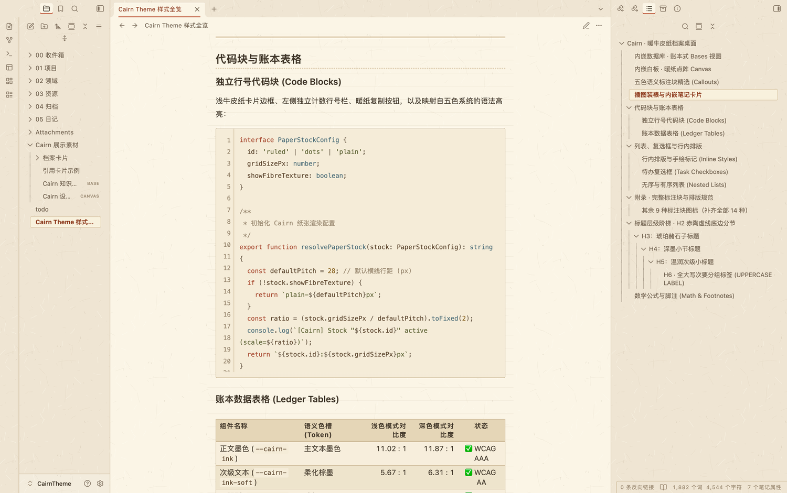

# Cairn

*Read this in: **English** | [中文](README.zh-CN.md)*

A **warm kraft-paper archive theme** for Obsidian — turning your vault into physical sheets and index cards laid across a sunlit desk. Warm paper neutrals, deep brown ink, and a single terracotta accent across both Light and darkroom Dark modes, with no pure white, pure black, or cool grays anywhere.

> **Lightweight & fast**: Every paper fibre, ink guide line, receipt tooth, paperclip, and washi tape strip is built with tiny pure-vector SVG tiles and native CSS — **zero `<feTurbulence>` filters, zero remote fonts or network requests, and zero scripts**, keeping long-note scrolling and multi-pane switching snappy.

## Highlights

- **Five-colour archival lifecycle**: Implements the [Project Cairn](https://github.com/iBlinkQ/project-cairn) palette — brick red (rules), moss olive (timeline), ochre gold (knowledge), warm stone (inputs), and slate blue (process) — mapped across 14 custom circular-badge Callout icons and Canvas cards.
- **Tactile stationery details**: Jagged-edge receipt frontmatter with a real-occlusion blue wire paperclip, folded-corner blockquote cards, unified warm photo-paper frames with translucent washi tape, hand-drawn marker highlights, line-numbered code blocks, and three-tier ledger tables.
- **Calm sidebar navigation**: Natural kraft-paper fibre desk, warm parchment slip on the active item, continuous soft pencil-ink indentation guides, and rounded `13px` ink collapse chevrons.
- **Native Bases & Canvas styling**: Obsidian **Bases** rendered as rounded archival ledger cards, **Canvas** styled as a warm dot-board with five-colour tinted cards and framed images, plus opaque internal note embeds and paper popovers.
- **Readable typography**: `16px` body, `1.8` line height, `42rem` line measure, wide tracking reserved strictly for labels and headers, and WCAG AA/AAA verified contrast across Light and Dark palettes.

## Screenshots

The five-colour callout system with custom circular stamp icons:

Obsidian **Bases** ledger tables and embedded **Canvas** dot-board preview:

**Canvas** warm dot-board with five-colour tinted cards and mounted photo-paper images:

Line-numbered code blocks and three-tier ledger tables:

Inline typography, hand-drawn marker highlights, checkboxes and nested lists:

## Install

- **From Obsidian**: Settings → Appearance → Themes → Manage → search for `Cairn`.
- **Manually**: Download `manifest.json` and `theme.css` from the [latest release](../../releases/latest) into `<vault>/.obsidian/themes/Cairn/`, then select Cairn under Settings → Appearance.

## Customise

Cairn works completely out of the box with **no third-party plugins required**.

- **Fonts & text size**: Change them anytime in **Settings → Appearance → Font** (Cairn only fills Obsidian's default sans-serif theme slots, so your native font settings always win).
- **Per-note overrides (no plugin needed)**: Add any of these classes to a note's `cssclasses` frontmatter property:
  - `cairn-stock-dots` (dot grid) / `cairn-stock-plain` (plain sheet)
  - `cairn-no-image-tape` (hide image washi tape)
- **Visual global controls (optional)**: Install the [Style Settings](https://github.com/obsidian-community/obsidian-style-settings) community plugin to adjust Cairn without writing CSS:
  - Accent, note surface, desk surface, ink, and hairline colours (Light and Dark separately)
  - Default font stack, line height, line width, and corner radius
  - Paper stock (ruled / dot grid / plain), ruled line & title rule colours, and quote card paper
  - Optional toggles: plain quote, hide image washi tape, underline internal links, and dim sidebars until hovered

## Acknowledgements

Paper tooth, index-card title ruling, receipt properties with paperclip, hand-drawn marker highlights and ink-line details draw inspiration from [Looseleaf](https://github.com/kevintngo/looseleaf) by Kevin Ngo, alongside the [Project Cairn](https://github.com/iBlinkQ/project-cairn) design language.

## License

MIT
